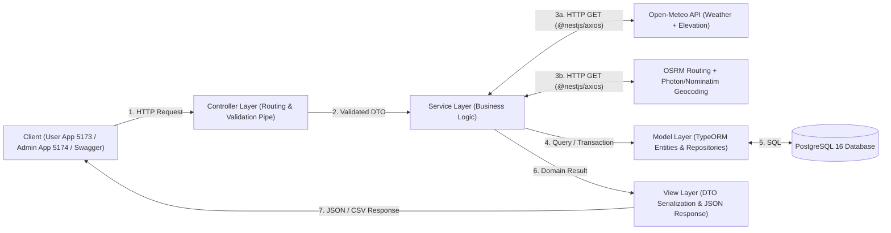
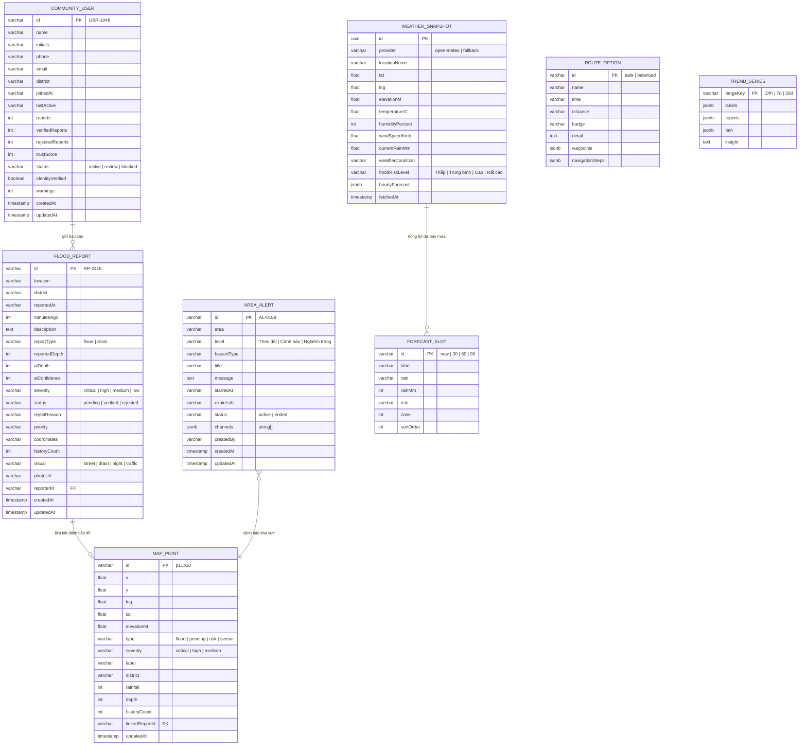
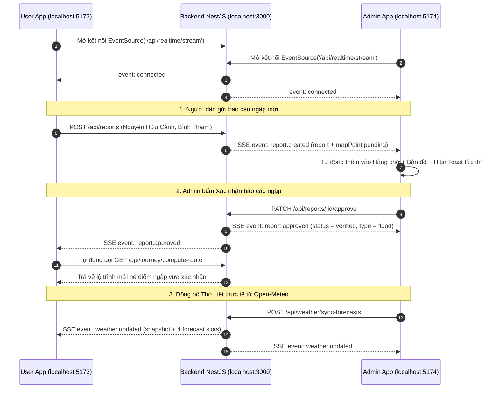

# BÁO CÁO KỸ THUẬT & KẾ HOẠCHXÂY DỰNG BACKEND
## DỰ ÁN: SAIGONDRAIN AI — HỆ THỐNG DẪN ĐƯỜNG AN TOÀN & ĐIỀU HÀNH CHỐNG NGẬP ĐÔ THỊ TP.HCM
**Kiến trúc:** Mô hình MVC (Model – View – Controller) trên nền tảng **NestJS Framework** & **PostgreSQL**

---

## 1. TỔNG QUAN DỰ ÁN & MỤC TIÊU HỆ THỐNG

### 1.1. Bối cảnh bài toán
Tại TP. Hồ Chí Minh, tình trạng mưa lớn kết hợp triều cường gây ngập cục bộ trên nhiều tuyến đường (Nguyễn Hữu Cảnh, Quốc Hương, Huỳnh Tấn Phát, Nguyễn Văn Quá, Phan Huy Ích...), gây mất an toàn cho người tham gia giao thông và tạo áp lực lớn cho trung tâm điều hành thoát nước đô thị.

**SaigonDrain AI** giải quyết bài toán bằng cách kết hợp **dữ liệu thời tiết/địa hình thời gian thực**, **bản đồ dẫn đường tránh ngập** và **báo cáo hiện trường từ cộng đồng có xác minh** trong một nền tảng thống nhất.

### 1.2. Vai trò của phân hệ Backend (`SaigonDrain_be`)
Phân hệ Backend đóng vai trò là trung tâm xử lý dữ liệu và điều phối nghiệp vụ cho cả 2 ứng dụng:
1. **Ứng dụng Người dân (`apps/user` - cổng `5173`)**: Cung cấp dự báo mưa theo mốc thời gian (`Hiện tại`, `+30 phút`, `+60 phút`, `+90 phút`), tính toán lộ trình an toàn né điểm ngập, tìm kiếm địa điểm và tiếp nhận báo cáo ngập/tắc cống từ hiện trường.
2. **Trung tâm Điều hành Admin (`apps/admin` - cổng `5174`)**: Cung cấp bản đồ giám sát 4 lớp (`Ngập`, `Nguy cơ`, `Mưa`, `Lịch sử`), hàng đợi duyệt/từ chối báo cáo cộng đồng, hệ thống phát cảnh báo khu vực đa kênh, quản lý điểm tin cậy người dùng (`trustScore`), xuất dữ liệu CSV và thống kê phân tích xu hướng (`24h / 7d / 30d`).

---

## 2. KIẾN TRÚC HỆ THỐNG THEO MÔ HÌNH MVC TRONG NESTJS

### 2.1. Giải thích mô hình MVC (Model – View – Controller) áp dụng cho NestJS RESTful Backend
Hệ thống được thiết kế theo kiến trúc **Feature Module kết hợp MVC** chuẩn của NestJS, đảm bảo tính đóng gói (Modularity), tách biệt trách nhiệm (Separation of Concerns) và dễ mở rộng:

| Tầng (Layer) | Thành phần trong NestJS (`src/modules/<feature>/`) | Trách nhiệm chính |
| :--- | :--- | :--- |
| **Model (M)** | `models/*.entity.ts` + TypeORM Repository | Định nghĩa cấu trúc bảng trong **PostgreSQL**, các ràng buộc toàn vẹn dữ liệu, kiểu dữ liệu (`jsonb`, `float`, `int`, `varchar`) và tương tác truy vấn SQL. |
| **View (V)** | `dtos/*.dto.ts` + Response Serialization + **Swagger UI (`/api/docs`)** | Định nghĩa cấu trúc dữ liệu đầu vào/đầu ra (Data Transfer Objects), kiểm tra hợp lệ (`class-validator`), chuẩn hóa định dạng JSON trả về cho Frontend React và hiển thị tài liệu tương tác trên Swagger. |
| **Controller (C)** | `controllers/*.controller.ts` | Tiếp nhận HTTP Request (`GET`, `POST`, `PATCH`, `DELETE`), trích xuất `@Param`, `@Query`, `@Body`, gọi tầng Service thực thi và trả về HTTP Response. |
| **Service (Business Logic)** | `services/*.service.ts` | Tầng trung gian hỗ trợ Controller xử lý toàn bộ nghiệp vụ phức tạp: gọi API thời tiết/bản đồ bên ngoài, chấm điểm lộ trình an toàn, tính độ sâu ngập AI, cập nhật điểm tin cậy người dùng và tổng hợp chỉ số KPI. |

### 2.2. Sơ đồ luồng xử lý kiến trúc MVC & External APIs



### 2.3. Cấu trúc thư mục dự án (`SaigonDrain_be`)

```text
SaigonDrain_be/
├── docker-compose.yml                  # Khởi tạo nhanh PostgreSQL 16 qua Docker
├── .env.example                        # Cấu hình biến môi trường mẫu
├── package.json
├── tsconfig.json
├── nest-cli.json
├── src/
│   ├── main.ts                         # Khởi chạy server, CORS, ValidationPipe, Swagger (/api/docs)
│   ├── app.module.ts                   # Root Module nạp Config, TypeORM và 8 Feature Modules
│   ├── common/
│   │   ├── interceptors/
│   │   │   └── transform.interceptor.ts
│   │   └── filters/
│   │       └── http-exception.filter.ts
│   ├── config/
│   │   └── typeorm.config.ts           # Cấu hình kết nối PostgreSQL
│   └── modules/
│       ├── weather/                    # 1. Module Thời tiết & Độ cao địa hình (Open-Meteo)
│       │   ├── controllers/weather.controller.ts
│       │   ├── services/weather.service.ts
│       │   ├── models/weather-snapshot.entity.ts
│       │   ├── dtos/query-weather.dto.ts
│       │   └── weather.module.ts
│       ├── map/                        # 2. Module Bản đồ, Geocoding (Photon/Nominatim) & Điểm giám sát
│       │   ├── controllers/map.controller.ts
│       │   ├── services/map.service.ts
│       │   ├── models/map-point.entity.ts
│       │   ├── dtos/query-map-points.dto.ts
│       │   ├── dtos/geocode-query.dto.ts
│       │   └── map.module.ts
│       ├── journey/                    # 3. Module Hành trình, Dự báo & Dẫn đường tránh ngập (OSRM)
│       │   ├── controllers/journey.controller.ts
│       │   ├── services/journey.service.ts
│       │   ├── models/forecast-slot.entity.ts
│       │   ├── models/route-option.entity.ts
│       │   ├── dtos/compute-route.dto.ts
│       │   └── journey.module.ts
│       ├── reports/                    # 4. Module Báo cáo ngập/cống cộng đồng
│       │   ├── controllers/reports.controller.ts
│       │   ├── services/reports.service.ts
│       │   ├── models/flood-report.entity.ts
│       │   ├── dtos/create-report.dto.ts
│       │   ├── dtos/review-report.dto.ts
│       │   ├── dtos/query-report.dto.ts
│       │   └── reports.module.ts
│       ├── alerts/                     # 5. Module Cảnh báo khu vực
│       │   ├── controllers/alerts.controller.ts
│       │   ├── services/alerts.service.ts
│       │   ├── models/area-alert.entity.ts
│       │   ├── dtos/create-alert.dto.ts
│       │   ├── dtos/update-alert.dto.ts
│       │   └── alerts.module.ts
│       ├── users/                      # 6. Module Người dùng cộng đồng & Điểm tin cậy
│       │   ├── controllers/users.controller.ts
│       │   ├── services/users.service.ts
│       │   ├── models/community-user.entity.ts
│       │   ├── dtos/update-user-status.dto.ts
│       │   └── users.module.ts
│       ├── analytics/                  # 7. Module Thống kê KPI & Phân tích xu hướng
│       │   ├── controllers/analytics.controller.ts
│       │   ├── services/analytics.service.ts
│       │   ├── models/trend-series.entity.ts
│       │   └── analytics.module.ts
│       └── seed/                       # 8. Module Tự động khởi tạo dữ liệu mẫu (Auto-Seed)
│           ├── services/seed.service.ts
│           └── seed.module.ts
└── test/
    └── app.e2e-spec.ts
```

---

## 3. CÔNG NGHỆ SỬ DỤNG & TÍCH HỢP API MIỄN PHÍ (TECH STACK & EXTERNAL APIS)

### 3.1. Công nghệ cốt lõi (Core Backend Stack)
- **Framework**: NestJS v11 (Node.js >= 22, TypeScript 5.7)
- **Cơ sở dữ liệu**: PostgreSQL 16
- **ORM (Tầng Model)**: TypeORM (`@nestjs/typeorm`, `typeorm`, `pg`)
- **HTTP Client**: `@nestjs/axios` & `axios` (gọi các API thời tiết và bản đồ)
- **Validation & Transformation**: `class-validator`, `class-transformer`
- **API Documentation**: `@nestjs/swagger` (OpenAPI 3.0)

### 3.2. Bộ API Thời tiết & Bản đồ miễn phí 100% (Không cần thẻ tín dụng / API Key)
Để thay thế hoàn toàn Google Maps Platform và các dịch vụ thời tiết trả phí mà vẫn đảm bảo chất lượng dữ liệu thời gian thực tại TP.HCM:

| Nhóm chức năng | Dịch vụ / API sử dụng | Endpoint chính | Ứng dụng trong SaigonDrain AI |
| :--- | :--- | :--- | :--- |
| **1. Thời tiết & Dự báo mưa** | **Open-Meteo Weather API** | `https://api.open-meteo.com/v1/forecast` | Lấy lượng mưa hiện tại (`rain`, `precipitation`), nhiệt độ, độ ẩm, tốc độ gió và dự báo mưa từng giờ cho TP.HCM & 7 quận trọng điểm. |
| **2. Độ cao địa hình (Vùng trũng)** | **Open-Meteo Elevation API** | `https://api.open-meteo.com/v1/elevation` | Lấy độ cao mặt đất (mét so với mực nước biển) tại tọa độ bất kỳ để đánh giá vùng trũng (như Nguyễn Hữu Cảnh, Thảo Điền). |
| **3. Tìm đường & Chỉ dẫn rẽ** | **OSRM Routing API** | `https://router.project-osrm.org/route/v1/driving` | Tìm nhiều lộ trình thay thế (`alternatives=true`), lấy polyline GeoJSON, thời gian, khoảng cách và các bước rẽ (`steps`). |
| **4. Tìm địa điểm (Autocomplete)** | **Photon API (by Komoot)** | `https://photon.komoot.io/api/` | Tìm kiếm nhanh tên đường, địa điểm tại TP.HCM (`lat=10.7769, lon=106.7009`) khi người dân nhập điểm đi/đến. |
| **5. Đổi tọa độ sang địa chỉ** | **Nominatim OSM API** | `https://nominatim.openstreetmap.org/reverse` | Reverse Geocoding: Tự động suy ra tên đường và Quận/Huyện khi người dân gửi báo cáo ngập bằng tọa độ GPS. |
| **6. Bản đồ nền Vector 3D** | **OpenFreeMap & CARTO** | `tiles.openfreemap.org/styles/liberty` & `basemaps.cartocdn.com` | Cung cấp style bản đồ Vector sắc nét, hiện đại như Google Maps / Uber Maps cho `maplibre-gl` trên Frontend. |

---

## 4. THIẾT KẾ CƠ SỞ DỮ LIỆU (DATABASE SCHEMA & ERD)

### 4.1. Sơ đồ quan hệ thực thể (ERD)



### 4.2. Mô tả chi tiết các bảng dữ liệu (Entities)
1. **`flood_reports` (`FloodReportEntity`)**: Lưu trữ báo cáo ngập đường hoặc tắc cống từ người dân, kèm theo độ sâu người dân ước lượng (`reportedDepth`), độ sâu do AI ước tính (`aiDepth`), độ tin cậy AI (`aiConfidence`), mức độ nghiêm trọng (`critical`, `high`, `medium`, `low`) và trạng thái duyệt (`pending`, `verified`, `rejected`).
2. **`map_points` (`MapPointEntity`)**: Lưu các điểm hiển thị trên bản đồ điều hành và bản đồ người dân (gồm điểm đang ngập `flood`, điểm chờ xác minh `pending`, điểm nguy cơ `risk`, và trạm cảm biến `sensor`), kèm tọa độ địa lý (`lat`, `lng`), tọa độ tương đối (`x`, `y`) và độ cao địa hình (`elevationM`).
3. **`area_alerts` (`AreaAlertEntity`)**: Lưu thông tin cảnh báo phát theo khu vực, cấp độ (`Theo dõi`, `Cảnh báo`, `Nghiêm trọng`), kênh phát (`Web`, `Push`, `Trung tâm điều hành`) và trạng thái hiệu lực (`active`, `ended`).
4. **`community_users` (`CommunityUserEntity`)**: Hồ sơ người đóng góp cộng đồng, thống kê tổng số báo cáo, số báo cáo được xác minh/từ chối, điểm tin cậy (`trustScore` trên thang 100) và trạng thái tài khoản (`active`, `review`, `blocked`).
5. **`weather_snapshots` (`WeatherSnapshotEntity`)**: Lưu lịch sử các lần gọi Open-Meteo Weather & Elevation API nhằm phục vụ phân tích và làm bộ nhớ đệm (fallback cache) khi mất kết nối mạng.
6. **`forecast_slots` (`ForecastSlotEntity`) & `route_options` (`RouteOptionEntity`)**: Lưu cấu hình các mốc dự báo mưa (`Hiện tại`, `+30 phút`, `+60 phút`, `+90 phút`) và các phương án lộ trình (`safe`, `balanced`) kèm chỉ dẫn từng bước (`navigationSteps`).
7. **`trend_series` (`TrendSeriesEntity`)**: Lưu chuỗi dữ liệu biểu đồ tương quan giữa lượng mưa (mm) và số lượng báo cáo ngập theo 3 khung thời gian `24h`, `7d`, `30d`.

---

## 5. ĐẶC TẢ CHI TIẾT CÁC ENDPOINT API (RESTFUL API SPECIFICATION)

### 5.1. Module Thời tiết & Độ cao Địa hình (`WeatherModule` — `/api/weather`)
| Method | Endpoint | Mô tả chức năng |
| :---: | :--- | :--- |
| `GET` | `/api/weather/current` | Gọi Open-Meteo API lấy thời tiết hiện tại + độ cao địa hình + dự báo 6 giờ tới tại tọa độ `lat, lng` (mặc định TP.HCM `10.7769, 106.7009`) và lưu snapshot vào DB. |
| `GET` | `/api/weather/districts` | Lấy dữ liệu mưa, nhiệt độ, độ cao địa hình và mức độ nguy cơ ngập đồng loạt cho 7 quận/huyện trọng điểm tại TP.HCM. |
| `POST` | `/api/weather/sync-forecasts` | Đồng bộ lượng mưa thực tế từ Open-Meteo vào bảng `forecast_slots` (`now`, `+30`, `+60`, `+90`) và cập nhật lượng mưa tại các trạm cảm biến. |
| `GET` | `/api/weather/history` | Lấy lịch sử các bản ghi thời tiết đã lưu trong PostgreSQL. |

### 5.2. Module Bản đồ, Geocoding & Địa hình (`MapModule` — `/api/map`)
| Method | Endpoint | Mô tả chức năng |
| :---: | :--- | :--- |
| `GET` | `/api/map/config` | Trả về danh sách URL Vector Map Styles miễn phí (OpenFreeMap Liberty, Bright, CARTO Voyager, Positron) và tọa độ tâm TP.HCM. |
| `GET` | `/api/map/points` | Lấy danh sách điểm bản đồ, hỗ trợ lọc theo lớp dữ liệu (`layers=flood,risk,rain,history`) và mức độ (`severity`). |
| `GET` | `/api/map/points/:id` | Xem chi tiết một điểm trên bản đồ kèm thông tin báo cáo liên kết (`linkedReport`). |
| `POST` | `/api/map/points` | Tạo mới điểm giám sát hoặc trạm cảm biến trên bản đồ. |
| `PATCH` | `/api/map/points/:id` | Cập nhật thông số lượng mưa (`rainfall`), độ sâu ngập (`depth`) của điểm bản đồ. |
| `GET` | `/api/map/geocode/search` | Tìm kiếm địa chỉ / Autocomplete tại TP.HCM qua **Photon (Komoot) API** (`?q=Nguyen Huu Canh`). |
| `GET` | `/api/map/geocode/reverse` | Reverse Geocoding qua **Nominatim OSM API**: Đổi tọa độ `?lat=...&lng=...` thành tên đường, phường, quận. |
| `GET` | `/api/map/elevation` | Lấy độ cao mặt đất (mét) từ **Open-Meteo Elevation API** và đánh giá nguy cơ trũng ngập tại tọa độ `?lat=...&lng=...`. |

### 5.3. Module Hành trình & Dẫn đường Tránh ngập (`JourneyModule` — `/api/journey`)
| Method | Endpoint | Mô tả chức năng |
| :---: | :--- | :--- |
| `GET` | `/api/journey/forecasts` | Lấy danh sách 4 mốc thời gian dự báo mưa và vùng nguy cơ (`zone`). |
| `GET` | `/api/journey/routes` | Lấy dữ liệu 2 phương án tuyến đường (`safe`, `balanced`), tọa độ `CAMPUS_1`, `MAIN_CAMPUS` và danh sách bước chỉ đường `navigationSteps`. |
| `GET` | `/api/journey/compute-route` | Gọi **OSRM Routing API** tính toán các lộ trình thực tế giữa 2 tọa độ, kiểm tra giao cắt với các điểm ngập trong DB để chấm điểm an toàn và dịch chỉ dẫn rẽ sang tiếng Việt. |

### 5.4. Module Báo cáo Ngập Cộng đồng (`ReportsModule` — `/api/reports`)
| Method | Endpoint | Mô tả chức năng |
| :---: | :--- | :--- |
| `GET` | `/api/reports` | Lấy danh sách báo cáo cộng đồng (lọc theo `status`, `severity`, `district`). |
| `GET` | `/api/reports/:id` | Xem chi tiết báo cáo kèm cảnh báo báo cáo trùng lặp gần đó (`duplicateWarning`). |
| `POST` | `/api/reports` | Người dân gửi báo cáo mới (tự động Reverse Geocode nếu thiếu địa chỉ, tự động tính `aiDepth` & `aiConfidence`, tạo `MapPoint` trạng thái `pending`). |
| `PATCH` | `/api/reports/:id/approve` | Điều phối viên xác nhận báo cáo (`status = 'verified'`), tự động chuyển `MapPoint` liên kết sang trạng thái `flood` và cộng điểm tin cậy cho người gửi. |
| `PATCH` | `/api/reports/:id/reject` | Điều phối viên từ chối báo cáo kèm lý do (`status = 'rejected'`). |

### 5.5. Module Cảnh báo Khu vực (`AlertsModule` — `/api/alerts`)
| Method | Endpoint | Mô tả chức năng |
| :---: | :--- | :--- |
| `GET` | `/api/alerts` | Lấy danh sách cảnh báo khu vực (lọc theo `status=active|ended`, `level`). |
| `GET` | `/api/alerts/:id` | Xem chi tiết một cảnh báo. |
| `POST` | `/api/alerts` | Phát cảnh báo khu vực mới tới các kênh (`Web`, `Push`, `Trung tâm điều hành`). |
| `PATCH` | `/api/alerts/:id` | Cập nhật nội dung, cấp độ hoặc thời gian hiệu lực của cảnh báo. |
| `PATCH` | `/api/alerts/:id/end` | Kết thúc cảnh báo sớm (`status = 'ended'`). |

### 5.6. Module Người dùng Cộng đồng (`UsersModule` — `/api/users`)
| Method | Endpoint | Mô tả chức năng |
| :---: | :--- | :--- |
| `GET` | `/api/users` | Lấy danh sách người dùng cộng đồng (lọc theo `status`, `district`, từ khóa `search`). |
| `GET` | `/api/users/export-csv` | Xuất danh sách người dùng ra file CSV chuẩn tiếng Việt UTF-8 BOM (`saigondrain-nguoi-dung.csv`). |
| `GET` | `/api/users/:id` | Xem hồ sơ chi tiết người dùng kèm tỷ lệ báo cáo chính xác (`approvalRate`). |
| `PATCH` | `/api/users/:id/status` | Cập nhật trạng thái tài khoản (`active` - Mở khóa, `review` - Đưa vào xem xét, `blocked` - Khóa tài khoản). |

### 5.7. Module Phân tích & Tổng quan Điều hành (`AnalyticsModule` — `/api/analytics`)
| Method | Endpoint | Mô tả chức năng |
| :---: | :--- | :--- |
| `GET` | `/api/analytics/overview` | Tổng hợp toàn bộ KPI điều hành: `reportStatusCounts`, `severityBreakdown`, `districtBreakdown`, `mapPointBreakdown`, `averageDepth`, `verificationRate`, `trustBands`, `topContributors`, `channelCoverage`, `alertLevelCounts`. |
| `GET` | `/api/analytics/trends` | Lấy dữ liệu biểu đồ xu hướng mưa và số lượng báo cáo theo khoảng thời gian (`?range=24h|7d|30d`). |

### 5.8. Module Khởi tạo Dữ liệu Mẫu (`SeedModule` — `/api/seed`)
| Method | Endpoint | Mô tả chức năng |
| :---: | :--- | :--- |
| `POST` | `/api/seed/reset` | Khôi phục toàn bộ cơ sở dữ liệu về trạng thái dữ liệu mẫu chuẩn của buổi thuyết trình Hackathon. |

### 5.9. Module Đồng bộ Thời gian thực (`RealtimeModule` — `/api/realtime`)
| Method | Endpoint | Mô tả chức năng |
| :---: | :--- | :--- |
| `GET (SSE)` | `/api/realtime/stream` | Kênh truyền **Server-Sent Events (SSE)** đẩy sự kiện thời gian thực 2 chiều giữa Backend, `apps/user` (5173) và `apps/admin` (5174). |
| `GET` | `/api/realtime/status` | Trả về trạng thái kết nối kênh truyền Realtime, tổng số sự kiện đã phát (`totalBroadcasts`) và mốc thời gian gần nhất (`lastEventAt`). |

---

## 6. THUẬT TOÁN & LOGIC NGHIỆP VỤ NỔI BẬT

### 6.1. Thuật toán chấm điểm Tuyến đường An toàn (`Safe Route Scoring`)
Khi người dùng yêu cầu tìm đường qua `/api/journey/compute-route`:
1. Backend gọi **OSRM API** với tham số `alternatives=true` để lấy các lộ trình khả thi từ điểm A đến điểm B.
2. Với mỗi lộ trình, Backend duyệt qua tập tọa độ `geometry.coordinates` và tính khoảng cách địa lý (**công thức Haversine**) tới tất cả các điểm đang ngập (`MapPoint` có `type = 'flood'` hoặc `FloodReport` đang `verified`/`pending`).
3. Nếu một lộ trình đi vào bán kính `< 300m` quanh điểm ngập:
   - Mức `critical`: cộng phạt `+50 điểm rủi ro`.
   - Mức `high`: cộng phạt `+30 điểm rủi ro`.
   - Mức `medium`: cộng phạt `+15 điểm rủi ro`.
4. Lộ trình có tổng điểm rủi ro thấp nhất được chọn làm **Tuyến đề xuất (`safe`)**, lộ trình còn lại làm **Tuyến dự phòng (`balanced`)**, kèm câu giải thích tự động chỉ rõ tuyến an toàn giúp né được những đường ngập nào.

### 6.2. Logic đánh giá Nguy cơ Ngập kết hợp Mưa & Địa hình (`Elevation + Rainfall Risk`)
Khi gọi `/api/weather/current` hoặc `/api/map/elevation`:
- Kết hợp **Lượng mưa hiện tại/dự báo ($R$, đơn vị mm)** từ Open-Meteo Weather API và **Độ cao mặt đất ($E$, đơn vị mét so với mực nước biển)** từ Open-Meteo Elevation API:
  - Khu vực có độ cao thấp trũng ($E \le 2.5\text{m}$, ví dụ Bình Thạnh, Thảo Điền, Quận 7, Nhà Bè) sẽ có hệ số nhạy cảm ngập $K = 1.4$.
  - Khu vực độ cao trung bình ($2.5\text{m} < E \le 6.0\text{m}$) có hệ số $K = 1.0$.
  - Khu vực đất cao ($E > 6.0\text{m}$) có hệ số $K = 0.7$.
- Chỉ số rủi ro ngập $I = R \times K$:
  - $I \ge 45$: **Rất cao** (`zone = 2`)
  - $25 \le I < 45$: **Cao** (`zone = 1`)
  - $10 \le I < 25$: **Trung bình** (`zone = 1`)
  - $I < 10$: **Thấp** (`zone = 0`)

---

## 7. KIẾN TRÚC ĐỒNG BỘ THỜI GIAN THỰC (REALTIME SSE 2 CHIỀU)

### 7.1. Sơ đồ luồng sự kiện Realtime giữa User App – Backend – Admin App



### 7.2. Bảng danh mục 9 sự kiện Realtime (`RealtimeEventType`)

| Tên sự kiện (`event`) | Nguồn phát trong Backend | Ứng dụng nhận & Phản ứng tức thì trên UI |
| :--- | :--- | :--- |
| `connected` | `RealtimeService.getStream()` | Xác nhận `apps/user` và `apps/admin` đã kết nối kênh truyền thời gian thực. |
| `heartbeat` | Chu kỳ mỗi `25 giây` | Giữ kết nối TCP/HTTP mở liên tục, chống ngắt kết nối (timeout). |
| `weather.updated` | `WeatherService.syncForecastsWithWeather()` | **User & Admin**: Cập nhật tức thì nhiệt độ trên `TopBar` và 4 mốc dự báo mưa (`now`, `+30p`, `+60p`, `+90p`). |
| `report.created` | `ReportsService.create()` | **Admin App**: Đẩy báo cáo mới lên đầu Hàng chờ, chấm thêm điểm `pending` trên bản đồ và bật Toast thông báo tức thì. |
| `report.approved` | `ReportsService.approve()` | **Admin & User App**: Chuyển điểm trên bản đồ sang `flood`, đồng thời **User App** tự động tính lại lộ trình né ngập. |
| `report.rejected` | `ReportsService.reject()` | **Admin App**: Cập nhật trạng thái báo cáo sang `rejected` trên mọi tab đang mở. |
| `alert.created` | `AlertsService.create()` | **Admin & User App**: Hiển thị cảnh báo khu vực mới và kích hoạt tính toán lại lộ trình an toàn. |
| `alert.updated` | `AlertsService.update()` | **Admin App**: Đồng bộ nội dung/thời hạn cảnh báo vừa chỉnh sửa. |
| `alert.ended` | `AlertsService.endAlert()` | **Admin & User App**: Kết thúc cảnh báo khu vực và cập nhật lại trạng thái lộ trình. |

---

## 8. KẾT QUẢ DỮ LIỆU THỰC TẾ BACKEND TRẢ VỀ CHO FRONTEND (JSON PAYLOADS)

### 8.1. Dữ liệu Sự kiện Realtime (`GET /api/realtime/stream`)
```json
// Sự kiện 1: Người dân gửi báo cáo ngập trên apps/user -> Admin nhận tức thì không cần F5
event: report.created
data: {
  "event": "report.created",
  "timestamp": "2026-11-04T06:28:15.102Z",
  "data": {
    "report": {
      "id": "RP-2420",
      "location": "Nguyễn Hữu Cảnh, Bình Thạnh",
      "status": "pending",
      "severity": "critical",
      "aiDepth": 30
    },
    "mapPoint": {
      "id": "p11",
      "label": "Nguyễn Hữu Cảnh, Bình Thạnh",
      "type": "pending",
      "lat": 10.7934,
      "lng": 106.7185
    }
  }
}

// Sự kiện 2: Admin xác nhận báo cáo -> User App tự động tính lại lộ trình né điểm ngập mới
event: report.approved
data: {
  "event": "report.approved",
  "timestamp": "2026-11-04T06:28:42.519Z",
  "data": {
    "message": "Đã xác nhận báo cáo RP-2420 và cập nhật bản đồ.",
    "report": { "id": "RP-2420", "status": "verified" },
    "updatedMapPoint": { "id": "p11", "type": "flood", "severity": "critical", "depth": 30 }
  }
}
```

### 8.2. Dữ liệu Thời tiết & Dự báo mưa (`GET /api/weather/current`)
```json
{
  "id": "c4423322-859f-499b-aa14-64b28f641317",
  "provider": "open-meteo",
  "locationName": "TP. Hồ Chí Minh",
  "lat": 10.7769,
  "lng": 106.7009,
  "elevationM": 2.2,
  "temperatureC": 27.5,
  "humidityPercent": 88,
  "windSpeedKmh": 18.5,
  "currentRainMm": 34,
  "weatherCondition": "Mưa lớn diện rộng",
  "floodRiskLevel": "Cao",
  "hourlyForecast": [
    { "time": "Hiện tại", "rainMm": 8, "precipitationProbability": 70, "temperatureC": 28.2 },
    { "time": "+30 phút", "rainMm": 34, "precipitationProbability": 90, "temperatureC": 27.4 },
    { "time": "+60 phút", "rainMm": 51, "precipitationProbability": 95, "temperatureC": 26.8 },
    { "time": "+90 phút", "rainMm": 23, "precipitationProbability": 75, "temperatureC": 27.1 }
  ]
}
```

### 8.3. Dữ liệu 4 mốc Dự báo Mưa & Lộ trình An toàn (`GET /api/journey/forecasts` & `GET /api/journey/routes`)
```json
// GET /api/journey/forecasts
[
  { "id": "now", "label": "Hiện tại", "rain": "8 mm", "rainMm": 8, "risk": "Thấp", "zone": 0, "sortOrder": 0 },
  { "id": "30", "label": "+30 phút", "rain": "34 mm", "rainMm": 34, "risk": "Cao", "zone": 1, "sortOrder": 1 },
  { "id": "60", "label": "+60 phút", "rain": "51 mm", "rainMm": 51, "risk": "Rất cao", "zone": 2, "sortOrder": 2 },
  { "id": "90", "label": "+90 phút", "rain": "23 mm", "rainMm": 23, "risk": "Giảm dần", "zone": 1, "sortOrder": 3 }
]
```

---

## 9. KẾT QUẢ KIỂM THỬ TOÀN HỆ THỐNG (UNIT TEST, BUILD & 21/21 E2E)

| Phân hệ | Hạng mục kiểm thử | Lệnh thực thi | Kết quả |
| :--- | :--- | :--- | :--- |
| **Backend (`SaigonDrain_be`)** | Biên dịch Production | `npm run build` | **PASS** (`0 lỗi`, tạo `dist/`) |
| **Backend (`SaigonDrain_be`)** | Unit Tests (`Weather`, `Journey`, `Reports`) | `npm test -- --runInBand` | **PASS** (`3/3 suites`, `4/4 tests`) |
| **Full-Stack E2E + Realtime** | Kiểm thử tích hợp 9 Modules + Realtime SSE + Luồng User ↔ Backend ↔ Admin | `npm run test:e2e -- --runInBand` | **PASS** (`21/21 kịch bản E2E` trong `6.3s`) |
| **Frontend User (`apps/user`)** | Kiểm tra kiểu TypeScript & Đóng gói Vite | `npm run typecheck && npm run build` | **PASS** (`0 lỗi`, build `505ms`) |
| **Frontend Admin (`apps/admin`)** | Kiểm tra kiểu TypeScript & Đóng gói Vite | `npm run typecheck && npm run build` | **PASS** (`0 lỗi`, build `874ms`) |

---

## 10. HƯỚNG DẪN KHỞI CHẠY ĐỒNG THỜI 3 CỔNG (REALTIME FULL-STACK)

```powershell
# Terminal 1 — Khởi chạy Backend (http://localhost:3000 & Swagger http://localhost:3000/api/docs)
cd C:\HACKATHON\SaigonDrain_be
npm run start:dev

# Terminal 2 — Khởi chạy User App (http://localhost:5173)
cd C:\HACKATHON\SaigonDrain_fe\apps\user
npm run dev

# Terminal 3 — Khởi chạy Admin App (http://localhost:5174)
cd C:\HACKATHON\SaigonDrain_fe\apps\admin
npm run dev
```


