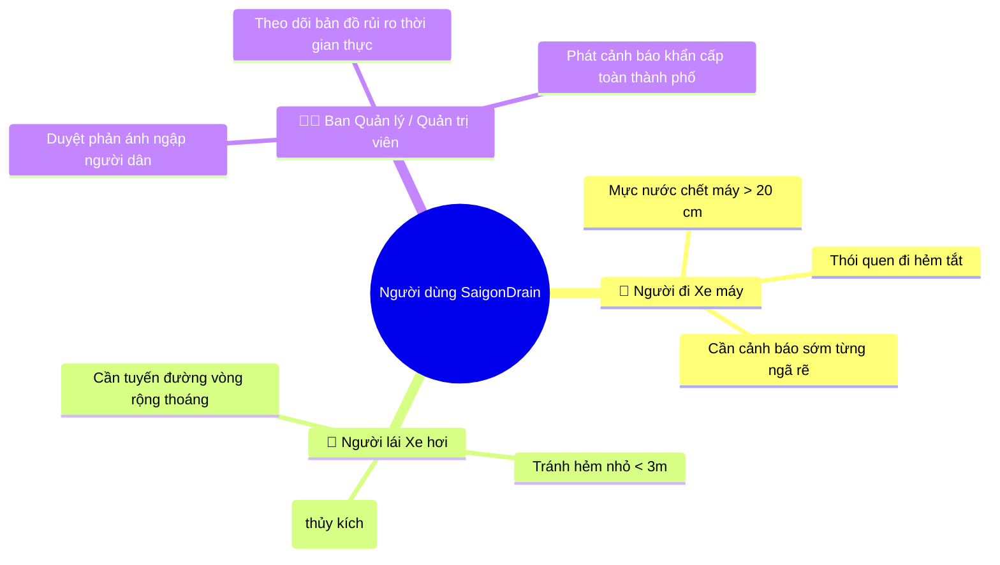
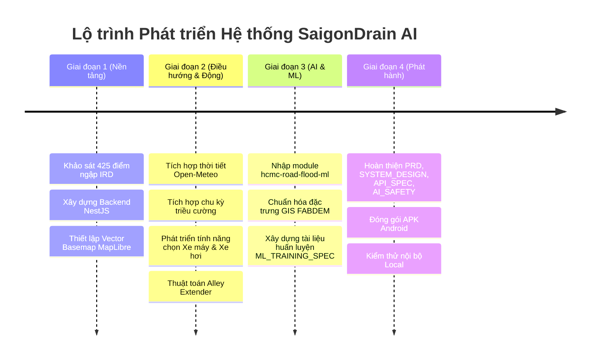

# PRODUCT REQUIREMENTS DOCUMENT (PRD)
## SaigonDrain AI — Hệ Thống Dự Báo Ngập & Điều Hướng Tuyến Đường An Toàn TP.HCM

**Mã tài liệu:** SD-PRD-2026-V2  
**Phiên bản:** 2.0.0 (Unified Monorepo Edition)  
**Ngày phát hành:** Tháng 11/2026  
**Chủ quản hệ thống:** Đội ngũ Kỹ thuật & Nghiên cứu SaigonDrain  
**Trạng thái:** Active Development  

---

## 1. Tổng quan & Tuyên ngôn Sản phẩm (Executive Summary)

### 1.1. Bối cảnh & Vấn đề thực tiễn
Thành phố Hồ Chí Minh là một trong những đại đô thị chịu ảnh hưởng nặng nề nhất Đông Nam Á bởi hiện tượng ngập lụt kép: sự kết hợp giữa **mưa nhiệt đới cực đoan** (lượng mưa $> 50\text{ mm/h}$) và **triều cường sông Sài Gòn – Đồng Nai** (đỉnh triều thường xuyên chạm mức $+1.60\text{ m}$ đến $+1.75\text{ m}$ tại trạm Phú An và Nhà Bè).
- Hơn **425 điểm đen ngập úng** kinh niên (theo số liệu thống kê khoa học IRD/DataSuds giai đoạn 2002–2026).
- Người tham gia giao thông đối mặt với rủi ro chết máy, thủy kích (hydrolock), té ngã trong hố ga/vùng nước sâu, tê liệt giao thông hàng giờ liền.
- Các ứng dụng bản đồ phổ biến (Google Maps, Apple Maps) hiện chỉ tối ưu theo thời gian di chuyển lý thuyết, hoàn toàn không có thông số về mức ngập nước, loại phương tiện chịu ngập hay hướng dẫn người dùng né tránh các tuyến đường ngập sâu.

### 1.2. Sứ mệnh Sản phẩm (Product Mission)
**SaigonDrain AI** là nền tảng bản đồ số và điều hướng giao thông thông minh đầu tiên tại TP.HCM kết hợp giữa **Mô hình Trí tuệ nhân tạo (Machine Learning Susceptibility)**, **Dữ liệu thủy triều & thời tiết thời gian thực** cùng **Cơ chế báo cáo cộng đồng (Crowdsourcing)**, cung cấp lộ trình di chuyển an toàn, khô ráo cho từng loại phương tiện (Xe máy và Xe hơi).

---

## 2. Đối tượng Người dùng & Chân dung (User Personas)

### Persona 1: Nguyễn Văn An — Người đi làm bằng Xe máy (🛵 Xe máy)
- **Hồ sơ:** 24 tuổi, nhân viên giao hàng và văn phòng, thường xuyên di chuyển giữa Quận Bình Thạnh và Quận 7.
- **Nỗi đau:** Xe tay ga có ống xả và bầu lọc gió thấp ($< 25\text{ cm}$); khi nước dâng $\ge 20\text{ cm}$ là chết máy, tốn chi phí sửa chữa hàng triệu đồng; thường xuyên đi trong các con hẻm nhỏ và không biết đầu hẻm có ngập hay không.
- **Nhu cầu:** Cần lộ trình xuất phát từ trong hẻm đi ra trục đường chính (Alley Navigation), cảnh báo cụ thể mực nước tại các điểm trũng (từng cm), đề xuất tuyến đường thay thế không ngập dù có xa hơn 1–2 km.

### Persona 2: Trần Thị Mai — Người lái Xe hơi cá nhân (🚗 Xe hơi)
- **Hồ sơ:** 36 tuổi, chuyên viên tài chính, đưa đón con nhỏ đi học hàng ngày qua các trục đường Quận 2, Quận Bình Thạnh.
- **Nỗi đau:** Lo sợ hiện tượng **thủy kích** (nước lọt vào buồng đốt làm cong tay biên / vỡ lốc máy) khi mực nước vượt quá $35\text{ cm}$; xe hơi không thể quay đầu hoặc chui qua các con hẻm nhỏ hẹp.
- **Nhu cầu:** Tuyến đường dành riêng cho ô tô tuyệt đối tránh hẻm nhỏ; tự động định tuyến đường vòng (detour) qua các đại lộ cao ráo; cảnh báo mức độ rủi ro ngập theo thời gian dự báo thời tiết.

### Persona 3: Quản trị viên Vận hành Đô thị & Thoát nước (Admin Portal)
- **Hồ sơ:** Ban chỉ huy phòng chống thiên tai & vận hành thoát nước đô thị.
- **Nhu cầu:** Xem trực quan toàn bộ mạng lưới điểm ngập trên nền tảng bản đồ số; thẩm định và phê duyệt các báo cáo ngập do người dân gửi lên; kích hoạt các thông báo đẩy (broadcast alerts) khi có triều cường đạt đỉnh.

---

## 3. Yêu cầu Tính năng Cốt lõi (Core Feature Specifications)

### F-01: Hệ thống Điều hướng Thông minh Đa phương tiện (Multi-Modal Routing Engine)
- **Lựa chọn loại phương tiện rõ ràng:**
  - 🛵 **Xe máy:** Cho phép lưu thông qua mạng lưới hẻm hợp lệ; ngưỡng rủi ro bắt đầu từ $15\text{ cm}$, phạt nặng lộ trình khi ngập $\ge 20\text{ cm}$.
  - 🚗 **Xe hơi:** Tự động loại trừ hẻm nhỏ (không dẫn xe vào đường hẹp $< 3\text{ m}$); ngưỡng rủi ro bắt đầu từ $25\text{ cm}$, cấm tuyệt đối khi ngập $\ge 35\text{ cm}$.
- **Thuật toán kết nối từ hẻm (Alley Extender):**
  - Khi tọa độ điểm xuất phát (Origin) nằm sâu trong hẻm, hệ thống tự động chiếu vuông góc (snap) ra mạng lưới giao thông công cộng gần nhất.
  - Tự động sinh chỉ dẫn điều hướng bước đầu tiên: *"Từ vị trí trong hẻm, đi thẳng ra trục đường chính (X mét)"*.
- **So sánh Tuyến đường Song song (Alternative Routing):**
  - Luôn cung cấp tối thiểu 2 phương án lộ trình có số km và thời gian thực tế khác biệt:
    1. **Tuyến đề xuất (Nhanh nhất / An toàn nhất):** Tuyến tối ưu về thời gian mà không cắt qua điểm ngập nguy hiểm.
    2. **Tuyến dự phòng (Ít điểm ngập):** Tuyến đường vòng né hoàn toàn các khu vực nhạy cảm ngập lụt.
- **Ẩn hiện thông minh (UI UX Flow):** Chỉ hiển thị tùy chọn phương tiện và danh sách lộ trình sau khi người dùng đã chọn đầy đủ Điểm đi và Điểm đến.

### F-02: Mô hình Thủy văn & Thời tiết Động (Dynamic Weather & Tidal Engine)
- **Tích hợp Open-Meteo Weather API:** Cập nhật lượng mưa dự báo theo giờ ($+0\text{h}, +30\text{m}, +60\text{m}, +90\text{m}$) với cấp độ rủi ro mưa:
  - $< 0.5\text{ mm/h}$: Không mưa / Rất thấp (Đường khô ráo).
  - $0.5 - 5.0\text{ mm/h}$: Mưa nhỏ / Thấp.
  - $5.0 - 15.0\text{ mm/h}$: Mưa vừa / Trung bình.
  - $> 15.0\text{ mm/h}$: Mưa to đến rất to / Nguy cơ ngập cao.
- **Mô phỏng Triều cường Động theo giờ (Dynamic Hourly Tidal Depth):**
  - Thay vì hiển thị con số đồng nhất, hệ thống tính toán mực nước ngập chi tiết cho từng điểm đen dựa trên cao độ lịch sử (`h.depth`), khoảng cách tới sông rạch và hàm sin biến thiên của chu kỳ bán nhật triều TP.HCM (đỉnh triều 05:00 - 07:00 sáng và 17:00 - 19:00 chiều).

### F-03: Tích hợp Trí tuệ Nhân tạo Đánh giá Nguy cơ Ngập (AI Flood Susceptibility)
- **Mô hình Học máy & MCDA:**
  - Nhập khẩu module nghiên cứu từ `ml/` (mô hình MCDA 5 tiêu chí: Cao độ FABDEM 30m, Độ dốc Horn 3x3, Khoảng cách thủy hệ, Chỉ số đô thị hóa ESA WorldCover, Mật độ điểm ngập IRD).
  - Chấm điểm nguy cơ ngập tương đối (0.00 – 1.00) cho từng phân đoạn đường.
  - Hiển thị huy hiệu kiểm định AI ("Mô hình ML xếp hạng an toàn", "Đoạn đường có nguy cơ địa hình trũng") giúp người dùng an tâm lựa chọn.

### F-04: Bản đồ Số Tương tác & Điều hướng Thời gian thực (Live GPS Navigation)
- Nền tảng bản đồ vector MapLibre GL 3D hiển thị mượt mà 60 FPS, không phụ thuộc API key tốn phí.
- Chế độ theo dõi GPS trực tiếp (Live Tracking) xoay bản đồ theo hướng di chuyển (bearing / heading), hiển thị chỉ dẫn từng bước (Turn-by-Turn directions).

### F-05: Cổng Báo cáo Cộng đồng & Kiểm duyệt Phản ánh (Crowdsourcing)
- Người dùng gửi phản ánh ngập tức thời: Tọa độ GPS tự động, chụp/tải ảnh hiện trường, ước tính mực nước (cm) và phương tiện có thể qua lại.
- Báo cáo mới hiển thị dưới dạng icon "Chờ duyệt" (Pending) màu vàng cam; khi Ban Quản trị phê duyệt sẽ chính thức chuyển sang điểm cảnh báo màu đỏ / nâu sẫm trên bản đồ toàn hệ thống.

### F-06: Ứng dụng Di động Native Android (Capacitor Bridge)
- Đóng gói ứng dụng di động hoàn chỉnh cho hệ điều hành Android (APK / Android App Bundle).
- Tối ưu hóa hiệu năng, loại bỏ hoàn toàn mã nguồn iOS để tập trung 100% trải nghiệm mượt mà trên các thiết bị Android phổ biến tại Việt Nam.

---

## 4. Yêu cầu Phi chức năng (Non-Functional Requirements)

| Tiêu chí | Chuẩn đo lường cam kết |
|---|---|
| **Thời gian phản hồi định tuyến (Routing Latency)** | $\le 1.5\text{ giây}$ cho lộ trình từ 5 – 25 km |
| **Tốc độ khung hình bản đồ (Map Rendering)** | Duy trì ổn định $60\text{ FPS}$ trên thiết bị Android tầm trung |
| **Khả năng chịu lỗi (Resilience & Fallback)** | Khi OSRM hoặc Google Routes gặp sự cố, tự động fallback về lộ trình lưu sẵn trong cơ sở dữ liệu SQLite/PostgreSQL |
| **Bảo mật & Quyền riêng tư (Privacy)** | Tọa độ GPS của người dùng chỉ xử lý trong phiên điều hướng cục bộ, không lưu vết danh tính người dùng |
| **Độ phủ dữ liệu (Data Completeness)** | Khảo sát và tích hợp dữ liệu ngập trên toàn bộ 24 quận/huyện và TP. Thủ Đức |

---

## 5. Lộ trình Triển khai (Milestones & Release Plan)

