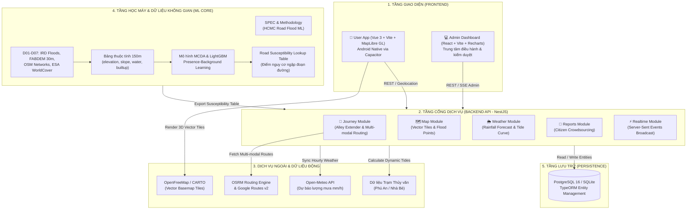
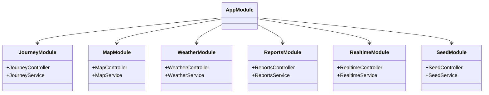
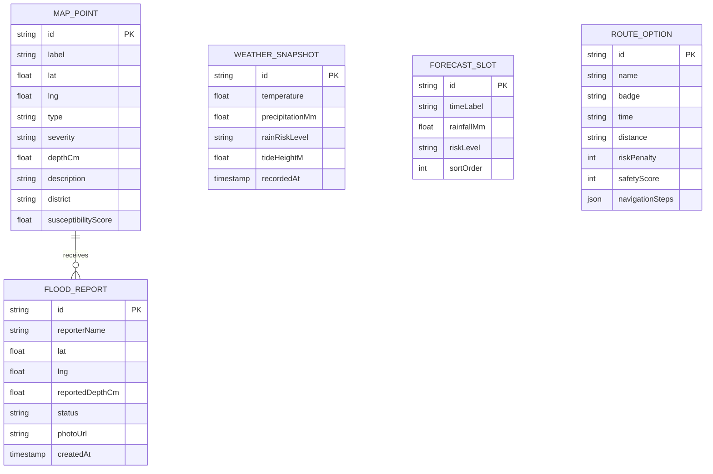

# SYSTEM DESIGN DOCUMENT
## SaigonDrain AI — Kiến Trúc Hệ Thống Dự Báo Ngập & Điều Hướng Thông Minh TP.HCM

**Mã tài liệu:** SD-SYS-2026-V2  
**Phiên bản:** 2.0.0 (Unified Monorepo Architecture)  
**Tác giả:** Đội ngũ Kỹ sư Hệ thống SaigonDrain & HCMC Road Flood ML  
**Trạng thái:** Implemented & Verified  

---

## 1. Kiến trúc Tổng thể Hệ thống (System Architecture Overview)

Hệ thống được tổ chức theo mô hình **Unified Monorepo**, phân tách rành mạch thành 4 tầng thành phần:



---

## 2. Thiết kế Chi tiết các Phân hệ (Subsystem Designs)

### 2.1. Phân hệ Frontend (`frontend/`)

Cấu trúc thư mục được quy hoạch chuẩn:
```text
frontend/
├── user/      # Ứng dụng di động người dùng cuối (Vue 3 + Vite + Capacitor Android)
└── admin/     # Bảng điều khiển quản trị viên đô thị (React + Vite + Recharts)
```

#### 2.1.1. Ứng dụng Người dùng (`frontend/user`)
- **Framework & Công nghệ:** Vue 3 (Composition API, `<script setup lang="ts">`), Vite, Tailwind CSS, Pinia store.
- **Bản đồ số & Điều hướng:** MapLibre GL tích hợp nguồn vector tiles miễn phí (OpenFreeMap Liberty / Bright / CARTO Voyager). Hỗ trợ định vị GPS thời gian thực (`navigator.geolocation` / Capacitor Geolocation), xoay bản đồ theo hướng di chuyển (bearing tracking), và hiển thị vệt đường ngập (polyline có phân màu rủi ro).
- **Trải nghiệm chọn phương tiện thông minh:**
  - Tùy chọn 🛵 **Xe máy** (mặc định) và 🚗 **Xe hơi** với chip chuyển đổi trực quan.
  - Toàn bộ tùy chọn lộ trình ("Tuyến đề xuất", "Tuyến dự phòng") và nút "Bắt đầu điều hướng" chỉ xuất hiện sau khi người dùng chọn xong cả Điểm đi và Điểm đến.
- **Cơ chế đóng gói Android Native:** Sử dụng `@capacitor/core` và `@capacitor/android`. Hỗ trợ chạy mượt mà trên thiết bị Android hoặc máy ảo Android Studio với cấu hình `capacitor.config.ts`. Đã loại bỏ hoàn toàn mã iOS dư thừa.

#### 2.1.2. Bảng Điều khiển Quản trị (`frontend/admin`)
- **Framework & Công nghệ:** React 18, TypeScript, Vite, Tailwind CSS, Lucide React, Recharts.
- **Chức năng:**
  - **Overview Page:** Thống kê tổng số điểm ngập đang hoạt động, lượng mưa hiện tại, mức cảnh báo triều cường đỉnh trong ngày, biểu đồ phân bố điểm ngập theo 24 quận/huyện.
  - **Reports Moderation Queue:** Tiếp nhận phản ánh ngập từ người dân, xem ảnh đính kèm, tọa độ, duyệt (Accept) hoặc từ chối (Reject) với cập nhật tức thời qua Server-Sent Events (SSE).
  - **Operations Map:** Bản đồ tác chiến trực quan hóa vùng rủi ro cao dựa trên dự báo thời tiết và dữ liệu ngập lịch sử.

---

### 2.2. Phân hệ Backend (`backend/`)

Xây dựng trên nền tảng **NestJS**, tuân thủ nghiêm ngặt nguyên lý Dependency Injection và cấu trúc module hóa:



#### 2.2.1. Thuật toán Định tuyến & Tránh ngập Đa phương tiện (`JourneyService`)
1. **Thuật toán Alley Extender (Kết nối từ Hẻm):**
   - Người dùng thường bắt đầu chuyến đi từ nhà riêng trong các con hẻm nhỏ không có tên đường chính thức trên bản đồ giao thông động.
   - Khi nhận tọa độ `(fromLng, fromLat)`, hệ thống tính khoảng cách Haversine tới nút giao trục đường gần nhất:
     $$d_{\text{start}} = \text{haversine}((\text{lat}_{\text{user}}, \text{lng}_{\text{user}}), (\text{lat}_{\text{road}}, \text{lng}_{\text{road}}))$$
   - Nếu $d_{\text{start}} > 8\text{ mét}$, thuật toán tự động bổ sung tọa độ điểm xuất phát vào chuỗi hình học (polyline) và sinh bước điều hướng mở đầu:
     `"Từ vị trí trong hẻm, đi thẳng ra [Tên đường] ([d] mét)"`.
2. **Quy tắc Trọng số theo Phương tiện (Vehicle-Specific Weighting):**
   - **🛵 Xe máy:**
     - Cho phép đi qua hẻm kết nối.
     - Phạt rủi ro (Risk Penalty) theo mức độ nghiêm trọng của điểm ngập trong bán kính 300m: `critical` = 50 điểm, `high` = 30 điểm, `medium` = 15 điểm.
     - Ngưỡng cảnh báo độ sâu: $\ge 15\text{ cm}$. Ngưỡng cấm: $\ge 20\text{ cm}$.
   - **🚗 Xe hơi:**
     - Tự động phạt nặng lộ trình đi qua đường hẹp hoặc hẻm cụt.
     - Phạt rủi ro ngập tăng gấp đôi so với xe máy vì nguy cơ hỏng động cơ (thủy kích) và khó quay đầu xe: `critical` = 120 điểm, `high` = 70 điểm.
     - Khi phát hiện tuyến đường chính bị ngập sâu, thuật toán tự động kích hoạt điểm trung gian (detour waypoint) để ép OSRM tìm tuyến đường vòng qua các đại lộ lớn.
     - Ngưỡng cảnh báo độ sâu: $\ge 25\text{ cm}$. Ngưỡng cấm: $\ge 35\text{ cm}$.
3. **Sinh Tuyến đường Đôi (Dual-Route Generation):**
   - Gọi OSRM API với tham số `alternatives=true`.
   - Nếu OSRM chỉ trả về 1 tuyến đường hoặc 2 tuyến có chiều dài/thời gian trùng lặp, hệ thống tự động chèn điểm uốn (midpoint detour vector) lệch $0.0055^\circ$ kinh độ / vĩ độ để tạo ra 2 lựa chọn có số km và thời gian thực tế rõ rệt: **Tuyến đề xuất** (ưu tiên an toàn/khô ráo) và **Tuyến dự phòng** (đường vòng thay thế).

#### 2.2.2. Động lực học Mực nước Động (`WeatherService` & `SeedService`)
- Dữ liệu lịch sử từ 425 điểm ngập IRD chứa thông số độ sâu trung bình (`h.depth`, từ $15\text{ cm}$ đến $60\text{ cm}$).
- Mực nước hiển thị không cố định mà biến thiên theo hàm chu kỳ triều cường thời gian thực:
  $$H_{\text{water}}(t, \text{point}) = h_{\text{depth}} \times \left(0.5 + 0.5 \times \sin\left(\frac{2\pi (t - t_{\text{peak}})}{12}\right)\right) + \Delta H_{\text{rain}}$$
  Trong đó:
  - $h_{\text{depth}}$: Chiều sâu ngập đặc trưng của từng tuyến đường.
  - $t_{\text{peak}}$: Thời điểm đỉnh triều trong ngày (buổi sáng $\approx 06:00$, buổi chiều $\approx 18:00$).
  - $\Delta H_{\text{rain}}$: Hệ số nước dâng do lượng mưa Open-Meteo hiện tại.

---

### 2.3. Phân hệ Trí tuệ Nhân tạo & Học máy (`ml/`)

Kế thừa kiến trúc nghiên cứu khoa học chuyên sâu từ `hcmc-road-flood-ml`:

```text
ml/
├── configs/                  # File cấu hình thí nghiệm, features, vùng nghiên cứu (YAML)
├── data/raw/manifest.yaml    # Bản kê mã băm SHA-256 nguồn dữ liệu khoa học
├── docs/                     # Tài liệu học thuật (methodology, model_card, data_card)
├── notebooks/                # Google Colab workflow (colab_first_workflow.ipynb)
├── scripts/                  # Bộ script thực thi (run_pipeline, train, evaluate)
├── src/flood_ml/             # Mã nguồn Python (features, labeling, training, utils)
├── tests/                    # Bộ kiểm thử đơn vị & tích hợp
├── ML_TRAINING_SPEC.md       # Đặc tả kỹ thuật huấn luyện mô hình chi tiết
└── pyproject.toml            # Môi trường quản lý gói uv / Python 3.12
```

- **Đơn vị phân tích:** Phân đoạn đường mục tiêu $150\text{ m}$ cắt theo nút giao OpenStreetMap trên địa bàn TP.HCM (EPSG:9210).
- **Bộ đặc trưng GIS:**
  1. `elevation_median_m`: Cao độ trung vị từ mô hình FABDEM 30m.
  2. `relative_elevation_m`: Chênh lệch cao độ lòng chảo so với bán kính lân cận 500m.
  3. `slope_mean_deg`: Độ dốc địa hình trung bình (thuật toán Horn $3 \times 3$).
  4. `dist_water_m`: Khoảng cách Euclid tới mạng lưới sông/kênh/rạch tự nhiên IRD.
  5. `builtup_ratio_250m`: Tỷ lệ bề mặt bê tông hóa đô thị từ ảnh vệ tinh ESA WorldCover 10m.
- **Phương pháp Mô hình hóa:**
  - **MCDA Baseline:** Chuẩn hóa robust bách phân vị $P_5 - P_{95}$, kết hợp 4 kịch bản trọng số (Equal, Terrain-Heavy, Water-Heavy, Built-up-Heavy).
  - **Track B (Presence-Background Learning):** Huấn luyện mô hình phân loại LightGBM / Regularized Logistic Regression kết hợp lấy mẫu nền (background sampling tỷ lệ 1:10) trên tập các đoạn đường chưa có báo cáo ngập.
  - **Ngăn chặn rò rỉ không gian:** Chia khối $2.000\text{ m} \times 2.000\text{ m}$ với vùng đệm an toàn $1.000\text{ m}$ (Spatial Guard).
- **Xuất bản Artifacts:** Điểm rủi ro tương đối (Susceptibility Score) được xuất ra file JSON nạp trực tiếp vào cơ sở dữ liệu backend của SaigonDrain.

---

## 3. Thiết kế Cơ sở Dữ liệu (Database Schema)

Hệ thống hỗ trợ song song PostgreSQL 16 (cho môi trường Production với Docker Compose) và SQLite (cho môi trường kiểm thử Local nhanh chóng):



---

## 4. Kiến trúc Triển khai & Vận hành (Deployment & Operations)

### 4.1. Chạy Cục bộ Độc lập (Local Development)
- Tận dụng các script tiện ích chuẩn bị sẵn:
  - `start-all.bat`: Khởi động toàn bộ giao diện người dùng và quản trị (`pnpm run dev`).
  - `start-backend.bat`: Khởi động máy chủ NestJS tại cổng 3000 (`npm run start:dev`).
  - `start-user.bat`: Khởi động ứng dụng người dùng tại cổng 5173.
  - `start-admin.bat`: Khởi động cổng quản trị tại cổng 5174.
  - `sync-android.bat`: Đồng bộ mã nguồn web sang dự án Android Studio.

### 4.2. Đóng gói Ứng dụng Di động Android
```bash
# 1. Build mã nguồn giao diện người dùng
cd frontend/user
pnpm run build

# 2. Đồng bộ asset và plugins sang thư mục Android Native
pnpm exec cap sync android

# 3. Mở mã nguồn trong Android Studio để ký số và xuất APK
pnpm exec cap open android
```
Tập tin Android Native nằm tại `frontend/user/android/` với đầy đủ cấu hình Gradle, quyền định vị GPS (`ACCESS_FINE_LOCATION`, `ACCESS_COARSE_LOCATION`) và giao diện hiển thị toàn màn hình.
